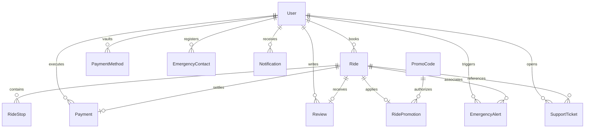

# ⚡ HopIn — Backend API & Real-Time Dispatch Engine

A high-concurrency, enterprise-grade REST API and WebSocket dispatch server for the **HopIn Cab Booking** ecosystem. Built on **Node.js**, **Express 5**, **Prisma ORM**, **PostgreSQL**, **Socket.IO**, and **Stripe**, HopIn delivers low-latency routing, automated driver simulation, cryptographic webhook-verified payments, and mission-critical safety features.

---

## 🌐 Server Health & Base URLs

| Target | Host / URL | Status Check |
| :--- | :--- | :--- |
| **Local API Server** | `http://localhost:3000` | `GET /health` |
| **WebSocket Engine** | `ws://localhost:3000` (Socket.IO) | Native Ping / Pong |
| **Frontend Client** | `http://localhost:5173` | CORS Whitelisted |

---

## 📋 Table of Contents

- [Overview](#-overview)
- [System Architecture & Data Flow](#-system-architecture--data-flow)
- [Core Features & Engineering](#-core-features--engineering)
- [Folder Structure](#-folder-structure)
- [Tech Stack](#-tech-stack)
- [Database Architecture & Prisma Models](#-database-architecture--prisma-models)
- [REST API Reference](#-rest-api-reference)
- [Real-Time WebSocket Events (Socket.IO)](#-real-time-websocket-events-socketio)
- [Security & Architecture Hardening](#-security--architecture-hardening)
- [Installation & Local Setup](#-installation--local-setup)
- [Available Scripts](#-available-scripts)
- [Dependencies](#-dependencies)
- [Automated Testing & Interactive Workflows](#-automated-testing--interactive-workflows)

---

## 🔍 Overview

The **HopIn Backend** coordinates all real-time events, financial transactions, and geographical route calculations for riders. Designed under a clean architectural model without legacy `/api` prefixes, every route is mounted cleanly at the top-level (e.g. `/auth`, `/rides`, `/payments`, `/maps`).

### What It Does

1. **Authentication & Session Security:** Issues encrypted JWT tokens housed in HTTP-only, secure, SameSite cookies with strict bcrypt password hashing.
2. **Geographical Computation:** Integrates OpenStreetMap Photon API for forward/reverse geocoding and Open Source Routing Machine (OSRM) for accurate driving distance polylines.
3. **Dynamic Pricing Engine:** Calculates base fares, per-kilometer travel rates, and time multipliers across 4 distinct vehicle tiers (Auto, Hatchback, Sedan, SUV).
4. **State Machine Dispatch Engine:** Governs ride transitions (`REQUESTED` → `ACCEPTED` → `DRIVER_ARRIVING` → `IN_PROGRESS` → `COMPLETED` or `CANCELLED`).
5. **Real-Time Telemetry Simulator:** Emits sub-second GPS coordinate streams, speed calculations, and dynamic heading angles to riders over Socket.IO rooms.
6. **PCI-DSS Compliant Stripe Gateway:** Generates payment intents, validates raw-body cryptographic Stripe webhook signatures (`stripe.webhooks.constructEvent`), and prevents replay attacks.
7. **Rider Safety & SOS Dispatch:** In-ride emergency triggers broadcast live alerts and store incident logs with emergency contact dispatches.
8. **Automated Help Desk:** Support ticketing system with categorization and instantaneous auto-response generation.

---

## 🔄 System Architecture & Data Flow

```mermaid
flowchart TD
    Client[Rider Client / Frontend] <-->|HTTP / HTTPS (Cookies)| Express[Express 5 Server :3000]
    Client <-->|WebSockets (ws://)| SocketIO[Socket.IO Server Engine]
    
    subgraph Express Application
        Security[Helmet + Rate Limiting + CORS] --> Router[Clean Top-Level Router]
        Router --> Controllers[Business Logic Controllers]
        Controllers --> Prisma[Prisma ORM Client]
        Controllers --> StripeSDK[Stripe Payment Gateway]
        Controllers --> GeoServices[Photon & OSRM Engine]
    end
    
    Prisma <--> PostgreSQL[(PostgreSQL Database)]
    
    subgraph Real-Time Telemetry
        SocketIO --> RideRooms["ride_{rideId} Room"]
        SocketIO --> UserRooms["user_{userId} Room"]
        SimEngine[Driver GPS Simulation Loop] --> SocketIO
    end
    
    StripeSDK <-->|Cryptographic Webhook| Express
```

---

## ✨ Core Features & Engineering

### 🔐 1. Authentication & User Profile
- **Bcrypt Hashing:** Passwords hashed with 10 salt rounds.
- **HTTP-Only Cookies:** Tokens stored in browser cookies immune to JavaScript DOM theft.
- **Session Introspection:** `GET /auth/me` validates active tokens and returns sanitized profile objects.

### 🗺️ 2. Geocoding & Routing Services
- **Photon & Nominatim Search:** High-accuracy location autocomplete with geographic bounds.
- **OSRM Polyline Computation:** Fetches real road polylines, duration in seconds, and distance in meters.
- **Haversine Distance Fallback:** Mathematical fallback computing great-circle distances if external map APIs experience downtime.

### 🚖 3. Multi-Tier Ride Engine
- **Vehicle Tiers:**
  - `AUTO`: Base $1.50 + $0.80/km
  - `HATCHBACK`: Base $2.00 + $1.00/km
  - `SEDAN`: Base $2.50 + $1.20/km
  - `SUV`: Base $3.50 + $1.60/km
- **Multi-Stop Support (`RideStop`):** Manage sequential intermediary stops with route recalculations.
- **Dynamic Cancellation Policy:** Configurable time boundaries with automated cancellation fee assessments.

### 📡 4. Socket.IO Telemetry & Simulation
- **Dedicated Broadcast Rooms:** Scoped channels (`ride_<id>` and `user_<id>`) ensuring complete tenant isolation.
- **Automated GPS Interpolation:** The simulation engine calculates 12 intermediate points between driver origin and destination, emitting heading angles (`Math.atan2`), simulated vehicle speeds (35–45 km/h), and dynamic ETAs.

### 💳 5. Stripe Payments & Cryptographic Signatures
- **Payment Intents:** Server-side intent generation with Stripe SDK.
- **Raw Body Signature Verification:** Captures `req.rawBody` buffer before JSON parsing to compute HMAC SHA-256 signatures against `STRIPE_WEBHOOK_SECRET`.
- **Saved Cards Vault:** Secure tokenization allowing riders to vault cards for 1-click checkout.

### 🛡️ 6. Safety SOS & Customer Support
- **Emergency Alerting:** Real-time SOS triggers recording GPS timestamps and linking emergency contacts.
- **Support Ticket Automation:** Structured ticket categorization (`PAYMENT`, `LOST_ITEM`, `DRIVER_ISSUE`, `RIDE_ISSUE`) with immediate resolution triggers.

---

## 📂 Folder Structure

```bash
backend/
├── app.js                         # Server bootstrap, Express 5 setup, middleware & Socket.IO
├── package.json                   # Dependencies, Prisma scripts & metadata
│
├── prisma/
│   ├── schema.prisma              # Complete PostgreSQL schema (13 models, 8 enums)
│   └── migrations/                # Database migration history
│
├── lib/
│   ├── prisma.js                  # Singleton Prisma Client instance
│   └── socket.js                  # Socket.IO initialization, rooms & driver simulation engine
│
├── routes/
│   ├── authRoute.js               # /auth (register, login, logout, me)
│   ├── profileRoutes.js           # /profile (view, update, password change)
│   ├── driverRoutes.js            # /driver (nearby drivers, driver credentials)
│   ├── mapRoute.js                # /maps (geocoding, routes, fare calculator)
│   ├── rideRoute.js               # /rides (booking, stops, status transitions, reviews, history)
│   ├── paymentRoutes.js           # /payments & /payment-methods (intents, webhooks, saved cards)
│   ├── promotionRoutes.js         # /promotions (coupon validation & discount calculation)
│   ├── emergencyRoutes.js         # /emergency-contacts (SOS alerts, trusted contacts)
│   └── supportRoutes.js           # /support (help desk tickets & resolutions)
│
├── controllers/
│   ├── authController.js          # Authentication business logic & JWT cookie issuance
│   ├── profileController.js       # Profile management and password hashing
│   ├── driverController.js        # Driver query and matching logic
│   ├── mapController.js           # Geocoding, reverse geocoding, OSRM polylines & fares
│   ├── rideController.js          # Complete ride lifecycle, multi-stops & reviews
│   ├── paymentController.js       # Stripe PaymentIntents, webhook verification & vaulting
│   ├── promotionController.js     # Promo code logic and boundary checking
│   ├── emergencyController.js     # SOS triggers and emergency contact CRUD
│   └── supportController.js       # Customer support ticket processing
│
└── scripts/
    ├── testDay13EndToEnd.js       # Full end-to-end multi-step verification test
    ├── testDay12Features.js       # Multi-stop, SOS, and support ticket test suite
    ├── testDay10Reviews.js        # Post-ride review and ratings test
    ├── testDay9History.js         # Pagination, filter, and history test
    └── testDay8Payment.js         # Stripe verified payment simulation test
```

---

## 🛠️ Tech Stack

| Technology | Version | Category | Purpose |
| :--- | :--- | :--- | :--- |
| **Node.js** | `>=18.x` | Runtime | High-throughput asynchronous JavaScript runtime |
| **Express** | `^5.3.0` | Framework | Modern Express 5 HTTP server with native promise handling |
| **Prisma ORM** | `^7.10.1` | Database ORM | Type-safe query engine and schema migrations |
| **PostgreSQL** | `>=14.x` | Database | Relational database with UUIDs, timestamps, and indexes |
| **Socket.IO** | `^4.8.4` | Real-Time | Low-latency bi-directional WebSocket communication |
| **Stripe** | `^23.0.0` | Payments | PaymentIntent generation and webhook signature verification |
| **Helmet** | `^8.3.0` | Security | Comprehensive HTTP security header protection |
| **Express Rate Limit** | `^8.7.1` | Security | Brute-force and DDoS rate-limiting protection |
| **JSON Web Token** | `^9.0.3` | Auth | Signed bearer tokens housed in secure cookies |
| **Bcrypt** | `^6.0.0` | Security | Industry-standard password hashing algorithm |
| **Zod** | `^4.6.7` | Validation | Runtime payload schema validation |
| **Cookie Parser**| `^1.4.7` | Middleware | Cookie serialization and deserialization |
| **CORS** | `^2.8.6` | Middleware | Cross-Origin Resource Sharing with credentials |

---

## 🗄️ Database Architecture & Prisma Models

The database schema (`backend/prisma/schema.prisma`) is tailored for a clean, single-actor Rider experience:



### Model Directory

| Model | Table | Description |
| :--- | :--- | :--- |
| `User` | `users` | Authenticated rider entity (Name, email, phone, password hash, profile image) |
| `Ride` | `rides` | Central ride transaction managing status, pickup/dropoff coords, fares, driver metadata |
| `RideStop` | `ride_stops` | Ordered intermediary waypoints for multi-stop journeys |
| `Payment` | `payments` | Settlement ledger tracking Stripe PaymentIntent IDs, amounts, and receipt URLs |
| `PaymentMethod` | `payment_methods` | Vaulted rider payment methods (Card tokens, UPI IDs, Wallets) |
| `PromoCode` | `promo_codes` | Coupon rules (Percentage/Fixed discount, min fare, max discount, expiry) |
| `RidePromotion` | `ride_promotions` | Association linking applied promo codes to rides |
| `Review` | `reviews` | Rider feedback and 1-5 star ratings for completed trips |
| `EmergencyAlert`| `emergency_alerts`| In-trip SOS trigger events with GPS coordinates and timestamps |
| `EmergencyContact`| `emergency_contacts`| Trusted phone contacts dispatched during emergency events |
| `SupportTicket` | `support_tickets` | Customer service tickets (`PAYMENT`, `LOST_ITEM`, `DRIVER_ISSUE`, `RIDE_ISSUE`) |
| `Notification` | `notifications` | System and ride event notifications |
| `CancellationPolicy`| `cancellation_policies`| Configurable cancellation grace periods and penalties |

---

## 🌐 REST API Reference

All endpoints are clean, top-level routes without `/api` prefixes.

### 1. Authentication (`/auth`)
| Method | Endpoint | Description |
| :--- | :--- | :--- |
| `POST` | `/auth/register` | Register a new rider account (Name, email, phone, password) |
| `POST` | `/auth/login` | Authenticate rider & issue HTTP-only JWT cookie |
| `POST` | `/auth/logout` | Clear auth cookie and terminate session |
| `GET` | `/auth/me` | Fetch currently authenticated rider profile |

### 2. Geocoding & Mapping (`/maps`)
| Method | Endpoint | Description |
| :--- | :--- | :--- |
| `GET` | `/maps/search?q={query}` | Forward geocode address query using Photon / Nominatim |
| `GET` | `/maps/reverse?lat={lat}&lon={lon}`| Reverse geocode coordinates to street address |
| `POST` | `/maps/route` | Compute driving polyline, distance in km, and duration via OSRM |
| `POST` | `/maps/calculate-fare` | Calculate tiered fare estimates across Auto, Hatch, Sedan, SUV |

### 3. Ride Lifecycle (`/rides`)
| Method | Endpoint | Description |
| :--- | :--- | :--- |
| `POST` | `/rides` | Request a new ride (Pickup, dropoff, rideType, promoCode) |
| `GET` | `/rides/history` | Paginated ride history with status and date filters |
| `GET` | `/rides/:id` | Retrieve comprehensive details of a specific ride |
| `PATCH` | `/rides/:id/status` | Transition ride state (`ACCEPTED`, `IN_PROGRESS`, `COMPLETED`) |
| `POST` | `/rides/:id/cancel` | Cancel an active ride with reason and policy enforcement |
| `POST` | `/rides/:id/stops` | Add an ordered intermediary waypoint to a ride |
| `GET` | `/rides/:id/stops` | List all waypoints associated with a ride |
| `POST` | `/rides/:id/review` | Submit a 1-5 star rating and written review |

### 4. Payments & Vault (`/payments` & `/payment-methods`)
| Method | Endpoint | Description |
| :--- | :--- | :--- |
| `POST` | `/payments/intent` | Create a Stripe PaymentIntent for an active ride |
| `POST` | `/payments/simulate-verified` | Webhook verification test validating signature & receipt |
| `POST` | `/payments/webhook` | Cryptographic Stripe Webhook endpoint (Raw buffer verified) |
| `GET` | `/payment-methods` | List vaulted payment methods for the rider |
| `POST` | `/payment-methods` | Vault a new payment method (Card / UPI) |
| `DELETE`| `/payment-methods/:id` | Remove a vaulted payment method |

### 5. Safety, Promotions & Support
| Method | Endpoint | Description |
| :--- | :--- | :--- |
| `POST` | `/promotions/validate` | Check promo code eligibility and return calculated discount |
| `GET` | `/emergency-contacts` | List verified emergency contacts |
| `POST` | `/emergency-contacts` | Register a new emergency contact |
| `POST` | `/emergency-contacts/trigger-sos`| Broadcast emergency alert with live GPS telemetry |
| `POST` | `/support/tickets` | Open a customer support ticket |
| `GET` | `/support/tickets` | View rider's submitted support tickets and responses |

---

## 📡 Real-Time WebSocket Events (Socket.IO)

Riders connect to the Socket.IO instance to receive low-latency updates:

| Event Name | Direction | Payload | Description |
| :--- | :---: | :--- | :--- |
| `join_ride` | Client → Server | `{ rideId, userId }` | Joins private `ride_{rideId}` room |
| `leave_ride` | Client → Server | `{ rideId }` | Leaves private ride room |
| `ride_status_update`| Server → Client | `{ rideId, status, ride }` | Signals ride state change |
| `driver_location_update`| Server → Client | `{ latitude, longitude, heading, speedKmh, remainingEtaMin }` | Emits live vehicle telemetry |
| `notification` | Server → Client | `{ title, message, type }` | In-app push notification alert |
| `payment_success` | Server → Client | `{ rideId, payment }` | Verified payment received via Stripe |
| `payment_failed` | Server → Client | `{ message }` | Payment failure notification |

---

## 🛡️ Security & Architecture Hardening

1. **Helmet HTTP Headers:** Prevents clickjacking, MIME sniffing, and cross-site framing attacks.
2. **Rate Limiting:** Protects all endpoints via `express-rate-limit` capped at 200 requests per 15-minute sliding window per IP.
3. **Strict CORS Policy:** Restricts access strictly to whitelisted frontend origins with credentials allowed.
4. **Raw Body Capture for Webhooks:**
   ```javascript
   app.use(express.json({
       limit: '50mb',
       verify: (req, res, buf) => {
           req.rawBody = buf; // Preserved for cryptographic HMAC verification
       }
   }));
   ```
5. **Database Parameterization:** Prisma ORM automatically prevents SQL injection via parameterized queries.

---

## 🚀 Installation & Local Setup

### Prerequisites
- **Node.js:** `v18.x` or higher
- **PostgreSQL:** Running instance with created database
- **Stripe Account:** (Optional for live keys, test keys supported)

### Step-by-Step Instructions

```bash
# 1. Navigate to the backend directory
cd backend

# 2. Install dependencies
npm install

# 3. Generate Prisma Client
npx prisma generate

# 4. Push schema to database
npx prisma db push

# 5. Start development server with Nodemon
npm run dev
```

Server will start on: **`http://localhost:3000`**

Verify database and server health:
```bash
curl http://localhost:3000/health
# Response: {"status":"ok","message":"HopIn Backend is healthy and database is connected"}
```

---

## 📜 Available Scripts

| Command | Action |
| :--- | :--- |
| `npm run dev` | Runs the Express API with `nodemon` auto-reload on file save |
| `npm start` | Launches server with standard `node app.js` |
| `npm run build` | Generates the latest Prisma client artifacts |
| `npm run postinstall` | Automatically triggers `prisma generate` during deployments |

---

## 📦 Dependencies

```json
{
  "dependencies": {
    "@prisma/client": "^7.10.1",
    "bcrypt": "^6.0.0",
    "cookie-parser": "^1.4.7",
    "cors": "^2.8.6",
    "dotenv": "^17.4.2",
    "express": "^5.3.0",
    "express-rate-limit": "^8.7.1",
    "helmet": "^8.3.0",
    "jsonwebtoken": "^9.0.3",
    "pg": "^8.23.1",
    "prisma": "^7.10.0",
    "socket.io": "^4.8.4",
    "stripe": "^23.0.0",
    "zod": "^4.6.7"
  },
  "devDependencies": {
    "nodemon": "^3.1.14"
  }
}
```

---

## 🧪 Automated Testing & Interactive Workflows

<details>
<summary><b>🤖 Click to expand: Run Automated End-to-End Test Suite</b></summary>

HopIn includes an end-to-end integration test validating the entire ride-hailing flow:

```bash
# Execute Day 13 complete verification suite
node scripts/testDay13EndToEnd.js
```

**Workflow Tested:**
1. Rider registration and JWT cookie session verification.
2. Forward geocoding of pickup and destination coordinates.
3. Multi-tier fare calculation with OSRM driving distance.
4. Promotional coupon application and discount validation.
5. Multi-stop intermediary waypoint insertion.
6. Ride dispatch creation and driver auto-assignment.
7. Real-time telemetry simulation and status transitions.
8. Stripe payment intent creation and cryptographic webhook settlement.
9. Perforated receipt verification and ride history archival.
10. In-ride SOS emergency alert triggering.
11. Help desk support ticket filing and automated resolution.
12. 5-star driver review submission.

</details>

<details>
<summary><b>📡 Click to expand: Sample Socket.IO Client Implementation</b></summary>

Connect to HopIn WebSockets from any client:

```javascript
import { io } from "socket.io-client";

const socket = io("http://localhost:3000", {
    withCredentials: true,
    transports: ["websocket", "polling"]
});

// Join the ride tracking room
socket.emit("join_ride", { rideId: "YOUR_RIDE_UUID", userId: "YOUR_USER_UUID" });

// Listen for status changes
socket.on("ride_status_update", (data) => {
    console.log("New Status:", data.status);
});

// Listen for live vehicle GPS telemetry
socket.on("driver_location_update", (location) => {
    console.log(`Car at: ${location.latitude}, ${location.longitude} heading ${location.heading}°`);
});

// Listen for verified payment
socket.on("payment_success", ({ payment }) => {
    console.log("Payment confirmed! Ref:", payment.providerPaymentId);
});
```

</details>

---

## 👥 Authors & License

- **HopIn Team** — High-performance mobility backend.
- **License:** ISC
